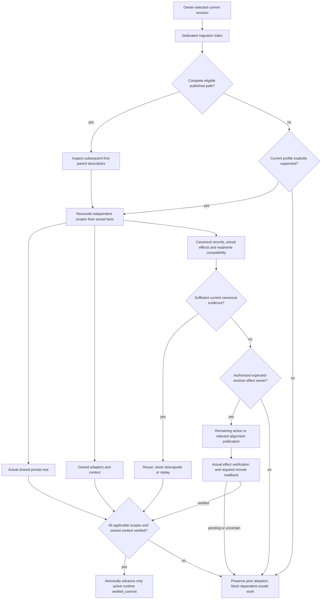

# History-independent migrations: terminal VERIFY

## Subject and attribution

Implemented the six proposals in the user-supplied `OOP_1791883441_history_independent_migrations.md`. All repository changes in this execution belong to that implementation; the initial working tree and index were clean. No independent task, consumer bootstrap, real operations migration, context compression, publication, history rewrite or provider configuration change was performed.

Local main and read-back remote main: `9a25ad22b714fb5db8e699e19c8187a97e70cf15`. Original committed tree: `31049ef85a6a7b898d9b7495dcef99c01537038d`. The implementation is an uncommitted working candidate, with no staged changes. Repository is public. The connected GitHub API has pull permission only; SSH remote reading succeeded, but write capability was neither assumed nor exercised. Signing remains configured; fixture commits disable signing only inside disposable local repositories.

Canonical runtime source identity: `sha256:435460d2e827111e657429f1a6f1560f34df982627683d23bd3b31ceff8466ef`.

Tested subject identity: `sha256:4cfc1e4f8f68c2f224cbf242476f245f9aa39faf22ab67a3202203d7eeb0365d`, covering 124 enumerated inputs. Exact current inputs were compared again to `release-acceptance.json` after testing. Source/package evidence binds bytes, never a future containing commit. This review is a completion artifact outside the producer subject inventory.

The remote baseline's [Producer tests run](https://github.com/organizationorchestrationprotocol/oop/actions/runs/38362089000) completed successfully on the baseline SHA. That result does not test or publish this candidate. No new remote CI was triggered.

## Actual verification

- Node `v24.19.0`: `accept-release.mjs --snapshot` passed all 120 distinct producer observations, with no failure, missing ID, unexpected ID, duplicate or skipped mandatory observation. The 116 distinct maintainer/report regressions also passed. Evidence: `release-acceptance.json`, `release-tests.tap`, `release-maintainer-tests.tap`.
- Inventory: 30 reference, 25 package, 22 safety/efficiency, nine organizational, ten routing/allocation, six current-content/path checks retaining the REL-GEN IDs, and 18 new migration checks. Superseded graph meaning was explicitly replaced by current-subject checks; no failing observation was hidden by shrinking the inventory.
- Generation reproduces exactly 37 modules and 56 source contracts. All source spans reconstruct without omissions or overlap, schema/references/route closure pass, and a repeated generation changed no tested input bytes. Abstract, Vision, Goal and the complete explanatory overview match the committed pre-change text exactly. Both role headings, BOOT-01–13 and independent security/authority semantics remain.
- The disposable migration fixture exercised DEF → GHI → LMN → OPQ: no transformations at GHI/OPQ, an explicit operations transformation at LMN, first-parent ordering excluding DEF, unincorporated branch exclusion, canonical shared-effect reuse and amended-path fallback. Other cases cover supported-state reconciliation with missing ancestry, separate roots and runtime ownership, partial effects, authority/CAS conflict, advanced operations, failed publication/readback, unsupported profiles, exact no-op declarations and context gating.
- A separate real shallow disposable clone passed committed current-release acceptance and `--check-current` without a historical baseline. Fixture root: `c33265f8d0f12297040cd8a7420bd70d6b52a4d0`. Fixture amended identity: `b39445780c55bd8740aaa0f545b5f9a463ce3d8f`; the old exact-revision evidence was refused after amend. These synthetic local commits are not OOP publication or consumer adoption. Checkout byte conversion was disabled in that fixture to preserve exact committed input bytes.
- All seven current selection/read/assembly measurements passed their complete-current-source control. Tokens, model calls, end-to-end installed runtime time and monetary savings remain unmeasured. Current selected governing bytes: fresh install 325950, enabled workspace 114294, ordinary G0 114294, authorized durable write 193040, due update 279309, context loss 118468, interrupted setup 328446.
- `git diff --check` passed. Changed tracked text had no mixed line endings or empty/whitespace-only EOF lines. No unrelated files were deleted, no private state was created and the index remained untouched.

Current candidate conformance is PASS; actual repository committed release readiness is false because the implementation is uncommitted. Comparative regression readiness remains false / NOT VERIFIED: no independently authenticated latest-comparable prior bundle was supplied. This is not a historical regression PASS. Installed/provider/cross-machine execution and deployment remain NOT PERFORMED. Semantic review was performed by the implementing AI, with no independent second reviewer claimed.

## Canonical normative source changes

Three reviewed runtime contracts change: `OOP-runtime-adoption`, new `OOP-migration-distribution`, and `OOP-producer-acceptance`. The other 53 complete runtime contracts remain verbatim. Adoption now discovers one dedicated index, safely obtains rewritten revisions without mutating the original checkout, and uses optional ordered history or current supported-state reconciliation. The new contract defines explicit scope dispositions, stable descriptor identities, independent common/runtime/operations facts, ownership, compatibility boundaries, idempotence, scoped recovery, no-downgrade policy and deduplicated signed canonical communication, including relevant no-transform alignments. Producer norms separate current conformance from independently grounded comparative assurance and require an explicit current semantic delta.

Exactly two representative normative BEFORE → AFTER examples, grounded in the actual PROTOCOL.md diff:

1. **Adoption:** BEFORE: “For an upgrade, inspect the relevant Git history and source changes between the verified adopted commit and target commit”. AFTER: “OOP ancestry is optional migration input only; no other runtime or producer flow requires prior commit objects, lineage comparison or historical source reconstruction.” Illustrative consequence: disappearance of DEF alone does not block a supported actual-state reconciliation.
2. **Rolling regression:** BEFORE: a comparison MUST use “the latest previously verified state immediately preceding the current change scope”, with stale selection causing release verification to fail. AFTER: a comparative claim uses an independently verified comparable prior content state; missing prior bytes/selection makes that claim NOT VERIFIED while current mandatory suites, semantic allocation/delta and migration review remain required. Illustrative consequence: shallow current conformance can pass without claiming longitudinal preservation.

Physical maintainer appendix edits separately replace the Genesis/ancestry acceptance rule and remove mandatory historical commit reconstruction from VERIFY. README, examples, changelog, tool documentation, CI depth, producer mechanisms and tests are implementation/documentation changes; regenerated JSON remains derived source-qualified authority.

## History/reference inventory and disposition

| Actual reference family | Classification | Disposition and reason |
| --- | --- | --- |
| Producer releaseGraph, root counting, shallow rejection, historical git log/show lookup, merge-base and latestPrior recursion | OOP producer ancestry dependency | Removed. Current HEAD/object input verification remains; comparative bundles are explicitly supplied and independently anchored. |
| Runtime upgrade's mandatory history/source-change walk and lack of release index | Conflicting OOP ancestry dependency | Replaced by one dedicated migration contract with ordered optional path and supported-state fallback. |
| `migration-contract.mjs` first-parent `rev-list` | Optional migration-only ancestry | Retained only in migration discovery. Missing/shallow/divergent ancestry returns to current compatibility reconciliation. No history commands remain in acceptance, efficiency or current-content helpers. |
| Current Git identity/ref, HEAD object reads, status, subject inventory, ordinary source publication | Current identity/transport/maintenance | Retained; no parent object is required and these do not imply adoption/publication. |
| Signed operations commits, canonical remote readback, expected-ref authority, organizational migration records and organizational history modules | Canonical organizational Git/history | Retained. These coordinate durable actual shared effects and must not be confused with OOP lineage. |
| Conversation, event, decision, reconstruction, handoff and historical evidence references | Ordinary human/organizational history | Retained verbatim outside the explicitly revised clauses; not an OOP ancestor requirement. |
| Former Genesis prose and tracked evidence | Superseded operational claims | Current docs/evidence replaced; the changelog preserves clearly labeled historical preparation context. Legacy technical filenames/IDs no longer activate a Genesis exemption. |

This inventory combines source/diff review, exact reconstruction and executable guards with textual searches; it is not a claim that keyword absence alone proves semantic equivalence.

## Supported states and state machine

Current compatibility covers the exact reviewed pre-change runtime fingerprint `sha256:9bb52974537f7b0dc6f74abdeb6494892adae9eedb503252f0ba5060739152cc` and the current runtime fingerprint, conditional on actual project/root/owner identity, interpretability, compatibility and absence of unknown partial effects. This does not claim automatic support for all historical or unmodified vendor adapters. Common requires no new data transformation. Runtime integration/context and applicable canonical operations verification/alignment are required independently. Operations data is preserved/grandfathered when compatible; its revision-specific descriptor explicitly declares no data transformation, while relevant absent canonical alignment evidence can require publication.

The diagram specifies the derived decision model; it is not an installed execution trace or new authority framework.

## Proposed Changes

**Impact notice: canonical runtime changes and derived regeneration are REQUIRED for PROP-01, PROP-02, PROP-03, PROP-04, PROP-05, PROP-06**, and both have been performed in this local candidate. PROP-05/PROP-06 also require physical maintainer appendix edits, performed separately. No history rewrite or provider setting change is part of the package.

1. **PROP-01 — Centralized Migration Distribution [MH-01; P1; IMPLEMENTED LOCAL CANDIDATE]**
   - **Scope and artifacts:** runtime/maintainer/documentation; source contract, migration JSON, generator, schema, entry/lifecycle and tests.
   - **Problem:** no single reviewed three-destination publication contract.
   - **Before example:** illustrative LMN update inferred migration from scattered material.
   - **Proposed change and after example:** explicit required/not_required/unknown index and optional descriptors; LMN obligations are discoverable and absent required metadata cannot mean no-op.
   - **Source and distribution impact:** Canonical normative source: REQUIRED — performed for descriptor authority; Derived distribution regeneration: REQUIRED — performed for discoverable exact closure.
   - **Pros and cons:** one authority and schema/semantic closure; supported-state declarations need ongoing review.
2. **PROP-02 — Three Independently Verified Alignments [MH-02; P1; IMPLEMENTED LOCAL CANDIDATE]**
   - **Scope and artifacts:** runtime/maintainer; canonical adoption clause, migration profiles, reference reconciler and tests.
   - **Problem:** peers/shared checkout cannot establish active runtime or another machine's common state.
   - **Before example:** illustrative A incorrectly adopts because B completed LMN.
   - **Proposed change and after example:** verify common root, own runtime and operations independently; A reuses B's canonical evidence but completes its own integration before advancing.
   - **Source and distribution impact:** Canonical normative source: REQUIRED — performed for ownership/checkpoints; Derived distribution regeneration: REQUIRED — performed for scoped decisions.
   - **Pros and cons:** preserves independent progress and prior state; more precise observation requirements, with no live adapter proof.
3. **PROP-03 — Canonical Synchronization and Races [MH-03; P1; IMPLEMENTED LOCAL CANDIDATE]**
   - **Scope and artifacts:** runtime/maintainer; canonical coordination, operations descriptor and race/readback tests; no real organizational write.
   - **Problem:** duplicate effects, false remote completion and backward alignment writes.
   - **Before example:** illustrative A and B replay one effect, or a failed push is treated as complete.
   - **Proposed change and after example:** scoped authority/CAS, actual-state reconciliation and deduplicated signed remote alignment; losing B rereconciles and reuses sufficient evidence.
   - **Source and distribution impact:** Canonical normative source: REQUIRED — performed for shared effect guarantees; Derived distribution regeneration: REQUIRED — performed for publication and failure guards.
   - **Pros and cons:** explicit cross-machine evidence and deduplication; real provider arbitration remains untested, existing authority still required.
4. **PROP-04 — Rewrite-Safe Compatibility [MH-04; P1; IMPLEMENTED LOCAL CANDIDATE]**
   - **Scope and artifacts:** runtime/maintainer; source contract, compatibility.json, path helper and migration fixtures.
   - **Problem:** prior SHA may disappear after amend/rewrite.
   - **Before example:** illustrative DEF cannot be retrieved when XYZ is selected.
   - **Proposed change and after example:** current supported-state predicates and stable requirements permit reconciliation without DEF; unsupported states keep scoped blockers and prior verification.
   - **Source and distribution impact:** Canonical normative source: REQUIRED — performed for fallback semantics; Derived distribution regeneration: REQUIRED — performed for current support coverage.
   - **Pros and cons:** supported updates survive lineage loss; coverage is explicitly bounded, not universal historical support.
5. **PROP-05 — History-Independent Acceptance [MH-05; P1; IMPLEMENTED LOCAL CANDIDATE]**
   - **Scope and artifacts:** maintainer and producer-specific runtime norms; acceptance/content/efficiency tools, inventories, CI, tests/evidence; physical maintainer appendix edited.
   - **Problem:** graph/Genesis/latestPrior gates prevented independent current conformance.
   - **Before example:** illustrative shallow checkout is rejected solely for missing parents.
   - **Proposed change and after example:** current conformance and exact committed bytes remain mandatory; portable independently anchored prior evidence supports separate comparative claims. Real shallow fixture passes current acceptance while its comparison remains NOT VERIFIED.
   - **Source and distribution impact:** Canonical normative source: REQUIRED — performed for REL/rolling meaning; maintainer appendix physical change: REQUIRED, performed; Derived distribution regeneration: REQUIRED — performed for producer contract.
   - **Pros and cons:** current quality without old objects; historical preservation is not certified without trustworthy comparable evidence.
6. **PROP-06 — Remove Conflicting Dependencies [MH-06; P2; IMPLEMENTED LOCAL CANDIDATE]**
   - **Scope and artifacts:** runtime/maintainer/documentation; source, physical appendix, README/examples/changelog/tool docs, CI and generated contracts.
   - **Problem:** scattered history obligations could restore the removed prerequisite.
   - **Before example:** illustrative generic upgrade/VERIFY requires unavailable OOP historical commits.
   - **Proposed change and after example:** isolate lineage traversal in migration discovery; other flows use current identities and attributable content/effect records. Preserve ordinary source-control and organizational history.
   - **Source and distribution impact:** Canonical normative source: REQUIRED — performed for one coherent adoption model; maintainer appendix physical change: REQUIRED, performed; Derived distribution regeneration: REQUIRED — performed for source-qualified closure.
   - **Pros and cons:** consistent model and beginner-facing explanation; semantic audit is reasoned rather than formal proof.

## Final Change-Impact Verdict

- **Canonical normative source change: REQUIRED — performed** for PROP-01, PROP-02, PROP-03, PROP-04, PROP-05, PROP-06: revised adoption/producer semantics and a dedicated migration contract.
- **Derived distribution regeneration: REQUIRED — performed** for PROP-01, PROP-02, PROP-03, PROP-04, PROP-05, PROP-06: exact source-qualified modules, locators, routes and migration descriptors; no installed consumer update is claimed.
- **Physical maintainer appendix change: REQUIRED and performed** for PROP-05/PROP-06, separately from runtime changes.
- **Freeze decision: FIX ONCE, THEN FREEZE**, limited to the verified local source/package candidate. Current implementation and required local checks pass; longitudinal, installed, provider, cross-machine and deployment claims remain bounded as stated above.

No repository commit, push, release, history replacement or settings mutation was authorized by ordinary execution of the prepared prompt or performed. The final VERIFY concerns the actual baseline HEAD plus the tested working candidate and the read-back unchanged remote main. Publication is intentionally outside this invocation, not an invented completed stage.
